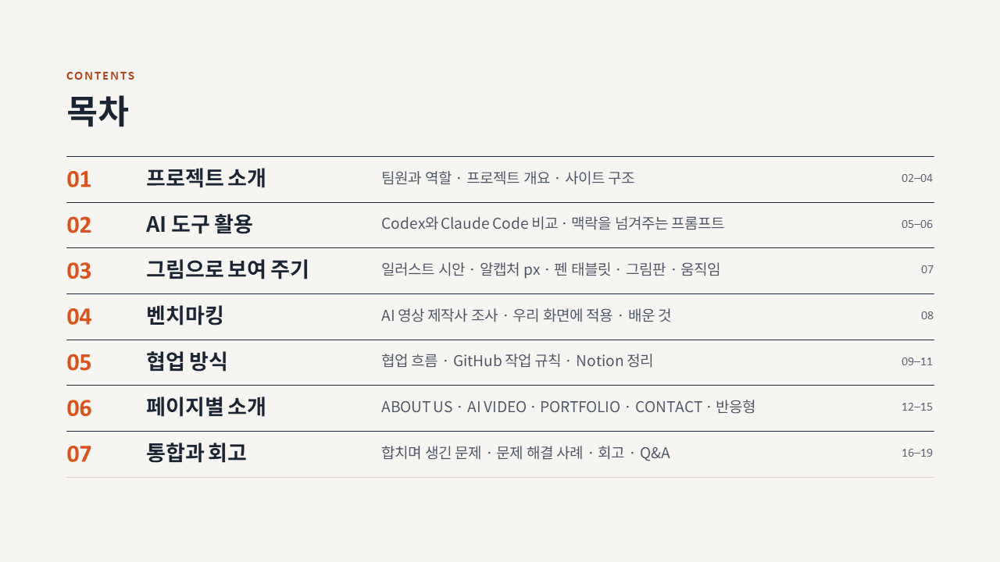
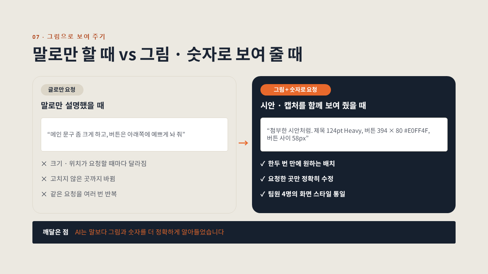
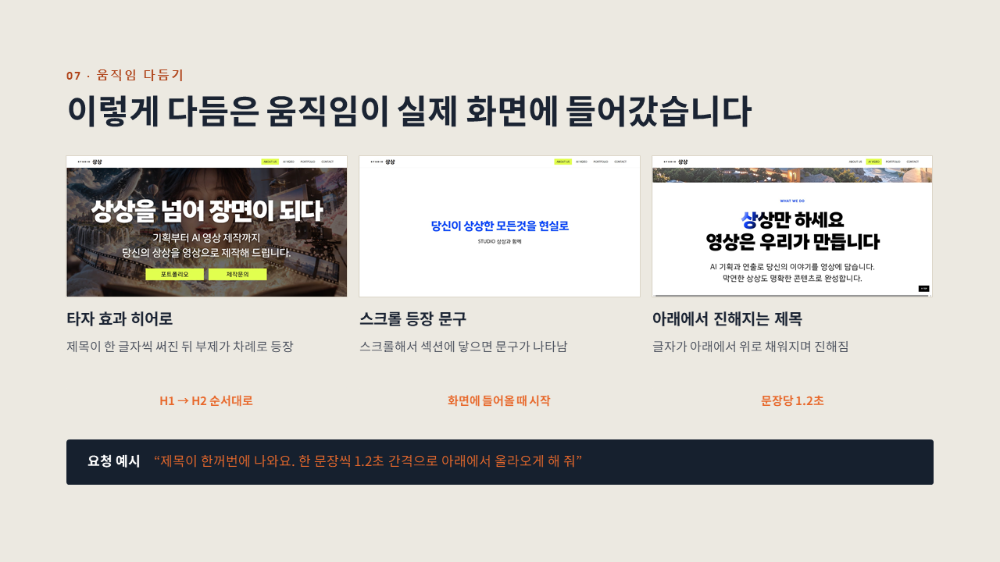
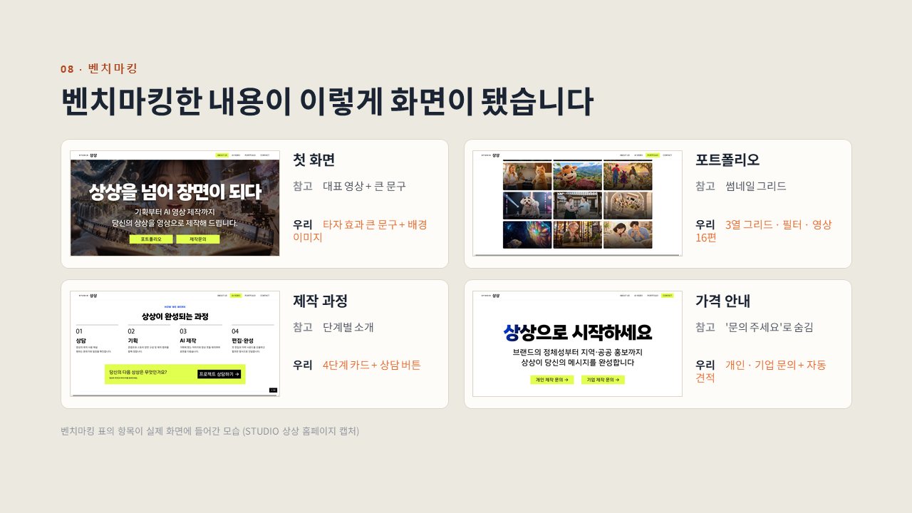

# STUDIO 상상 · 팀 프로젝트 발표 자료

2차 팀 프로젝트 **STUDIO 상상 통합 홈페이지**(Codex · Claude Code로 만든 AI 영상 제작사 홈페이지)의 발표 PPT입니다.
Claude Code와 함께 슬라이드를 만들고 정리했습니다.

| 파일 | 내용 |
|---|---|
| `STUDIO 상상 팀 프로젝트 발표_최종본.pptx` | **최종 발표본 (46장)** — 본편 30장 + 추가 슬라이드 16장을 합친 버전 |
| `STUDIO 상상_추가슬라이드_그림으로보여주기_벤치마킹_v2.pptx` | 추가 슬라이드 16장만 따로 모은 파일 |
| `preview/` | 주요 슬라이드 미리보기 이미지 |

## 목차 (최종본)

| | 섹션 | 내용 | 슬라이드 번호 표시 |
|:---:|---|---|:---:|
| 01 | 프로젝트 소개 | 팀원과 역할 · 프로젝트 개요 · 사이트 구조 | 02–04 |
| 02 | AI 도구 활용 | Codex와 Claude Code 비교 · 맥락을 넘겨주는 프롬프트 | 05–06 |
| 03 | 그림으로 보여 주기 | 일러스트 시안 · 알캡처 px · 펜 태블릿 · 그림판 · 움직임 | 07 |
| 04 | 벤치마킹 | AI 영상 제작사 조사 · 우리 화면에 적용 · 배운 것 | 08 |
| 05 | 협업 방식 | 협업 흐름 · GitHub 작업 규칙 · Notion 정리 | 09–11 |
| 06 | 페이지별 소개 | ABOUT US · AI VIDEO · PORTFOLIO · CONTACT · 반응형 | 12–15 |
| 07 | 통합과 회고 | 합치며 생긴 문제 · 문제 해결 사례 · 회고 · Q&A | 16–19 |

## 추가 슬라이드 16장 — AI에게 "그림으로 보여 주기"와 벤치마킹

AI가 만든 결과가 시안과 안 맞을 때, 말 대신 **그림과 숫자**로 보여 주며 수정한 과정과 다른 AI 영상 제작사 홈페이지를 조사한 **벤치마킹** 내용을 정리했습니다.

| 번호 | 제목 |
|:---:|---|
| 1 | 말로 안 될 땐, 그림으로 보여 줬습니다 |
| 2 | 말로만 할 때 vs 그림 · 숫자로 보여 줄 때 |
| 3 | 도구별로 이렇게 나눠 썼습니다 (Illustrator · 알캡처 · 펜 태블릿 · 그림판) |
| 4 | 일러스트 시안을 보여 주고, 이렇게 완성했습니다 |
| 5 | 시안 하나로 배치 · 색 · 문구를 한 번에 전달 |
| 6 | 알캡처로 재고, 숫자로 요청했습니다 |
| 7 | 수정 요청은 이 공식으로 썼습니다 |
| 8 | 고칠 곳은 그림판 · 펜 태블릿으로 표시했습니다 |
| 9 | AI가 자주 어긋난 곳과 해결 방법 |
| 10 | 움직임은 참고 사이트를 보고, 대화로 다듬었습니다 |
| 11 | 이렇게 다듬은 움직임이 실제 화면에 들어갔습니다 |
| 12 | 벤치마킹은 이렇게 했습니다 |
| 13 | 벤치마킹 — AI 영상 제작사 홈페이지를 조사했습니다 |
| 14 | 벤치마킹한 내용이 이렇게 화면이 됐습니다 |
| 15 | 조사해 보니 없던 것, 우리가 더했습니다 |
| 16 | AI와 함께 만들며 배운 것 |

<table>
  <tr>
    <td></td>
    <td></td>
  </tr>
  <tr>
    <td align="center">말로만 할 때 vs 그림 · 숫자로 보여 줄 때</td>
    <td align="center">움직임이 실제 화면에 들어간 모습</td>
  </tr>
  <tr>
    <td colspan="2"></td>
  </tr>
  <tr>
    <td colspan="2" align="center">벤치마킹한 내용이 화면이 된 모습</td>
  </tr>
</table>

## 남은 작업

- 벤치마킹 표의 `[사이트 이름 1~3]` — 실제 조사한 사이트 이름 채우기
- 반응형 비교 슬라이드의 모바일 캡처 — 모바일 버전 수정 후 넣기
- 회고 슬라이드의 팀원별 한 줄 소감

---
팀 **인생2막** · 2026.10
