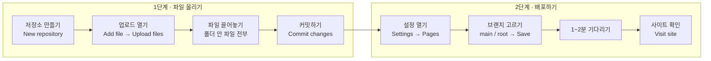

# 깃허브 배포 공부 노트 (2026-10-20)

GitHub 웹사이트에서 파일을 올리고, GitHub Pages로 홈페이지를 배포하는 방법을 정리했다.

## 전체 순서



## 1단계 · 파일 올리기 (웹에서)

1. GitHub에서 **New repository**로 저장소를 만든다.
   - **Add a README file**에 체크하면 README.md가 자동으로 생긴다.
   - **Description**에 적은 글이 README.md 둘째 줄에 들어간다.
2. 저장소 화면에서 **Add file → Upload files**를 누른다.
3. 큰 네모 칸("Drag files here…")에 파일을 끌어놓는다. 또는 **choose your files**로 고른다.
   - 폴더째 올리지 말고, **폴더를 열어서 안에 있는 파일과 하위 폴더를 전부** 끌어놓는다.
   - 그래야 `index.html`이 저장소 맨 위에 와서 배포가 제대로 된다.
4. 아래 **Commit changes** 칸에 무엇을 올렸는지 한 줄 적고, 초록색 **Commit changes** 버튼을 누른다.

## 2단계 · 배포하기 (GitHub Pages)

1. 저장소 위쪽 메뉴에서 **Settings**를 누른다.
2. 왼쪽 메뉴에서 **Pages**를 누른다.
3. **Source**는 `Deploy from a branch` 그대로 둔다.
4. **Branch**를 `None` → `main`으로 바꾸고, 폴더는 `/ (root)`로 둔 뒤 **Save**를 누른다.
   - `main`: 어느 브랜치의 파일을 쓸지
   - `/ (root)`: 저장소 맨 위의 파일을 쓴다는 뜻이다. 그래서 맨 위에 `index.html`이 있어야 한다.
5. 1~2분 기다리면 위에 **"Your site is live at …"** 상자가 생긴다.
6. **Visit site**를 누르면 홈페이지가 열린다.

- 사이트 주소 모양: `https://아이디.github.io/저장소이름/`
- 배포를 끄려면 같은 화면에서 **Unpublish site**를 누른다.

## README.md는 왜 만들까?

- 저장소의 **안내문**이다. 저장소 첫 화면의 파일 목록 아래에 자동으로 보인다.
- 보통 이런 내용을 적는다: 프로젝트 이름과 소개, 배포 주소, 사용 기술, 파일 구성, 만든 사람
- 포트폴리오로 쓸 때 다른 사람이 가장 먼저 읽는 파일이다.
- 수정하려면 README.md를 열고 연필(✏️ Edit) 버튼을 누른 뒤 **Commit changes**를 누른다.

### 마크다운(.md) 기본 문법

| 이렇게 쓰면 | 이렇게 보인다 |
|---|---|
| `# 제목` | 큰 제목 |
| `**굵게**` | **굵게** |
| `- 항목` | 점 목록 |
| `[링크](주소)` | 누를 수 있는 링크 |

### README 예시

```markdown
# 상상 스튜디오 홈페이지

AI 영상 제작 문의 페이지입니다.

## 사이트 주소
https://아이디.github.io/저장소이름/

## 사용 기술
- HTML / CSS / JavaScript

## 파일 구성
- index.html : 시작 페이지
- personal.html / corporate.html : 개인·기업 문의 페이지
- assets : 이미지, 영상, 글꼴
```

## 참고 · 명령어로 올리는 방법 (git)

웹 업로드 대신 터미널에서 올릴 수도 있다. 파일을 고친 뒤 아래 세 줄을 차례로 실행한다.

```bash
git add .
git commit -m "수정 내용"
git push
```

## 알아둔 점

- 저장소 이름을 한글로만 지으면 GitHub가 이름을 `-`로 바꿔버린다. 영어 이름을 쓰는 게 좋다.
- 공개(Public) 저장소에는 비밀번호나 API 키가 들어간 파일을 올리지 않는다.
